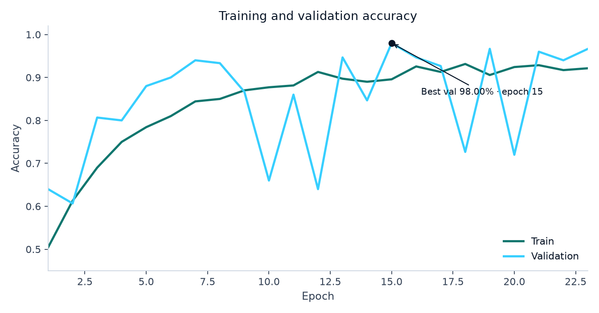
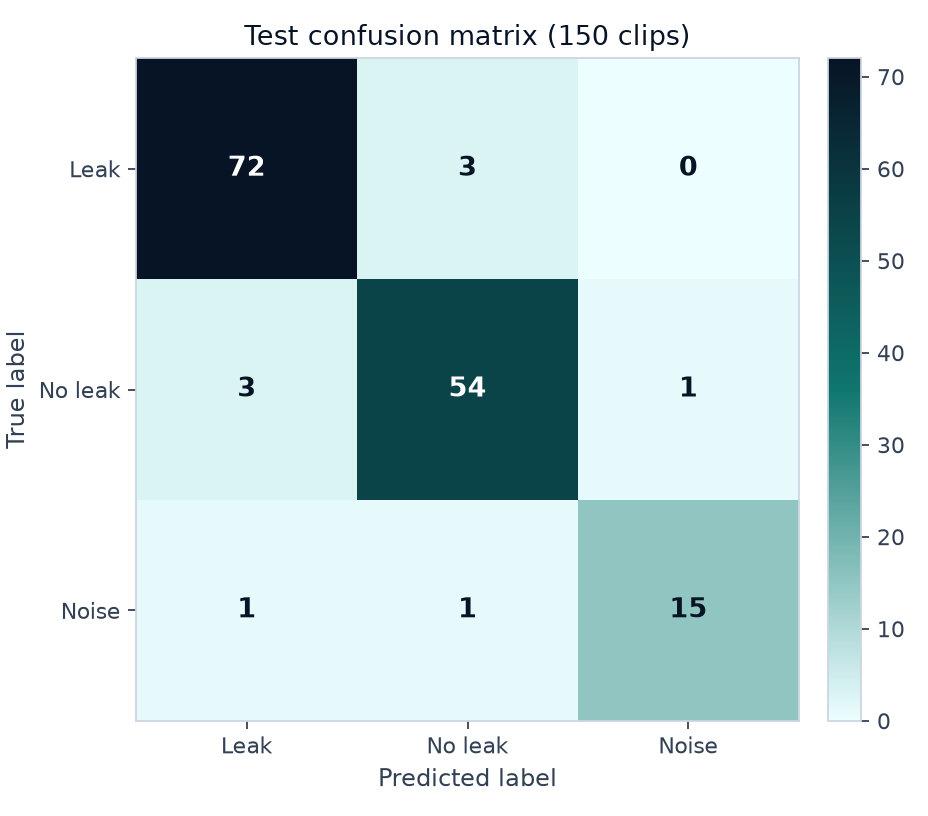

# Smartphone Audio Water-Pipe Leakage Detection

## Abstract

This project trains a compact convolutional network to classify one-second acoustic clips of a water pipe as leak, no leak, or environmental noise. The public training set is 1,000 field recordings from a water-distribution leakage-detection site (Zenodo record 18631450). Audio is resampled to 16 kHz, converted to a 64-bin log-mel spectrogram, and classified by a four-block CNN. On a held-out test split of 150 clips the model reaches 94.00% accuracy and 93.13% macro F1. Weights, an ONNX copy, a prediction script, and a browser demo are published for evaluation.

## Problem statement

Hidden household and distribution-pipe leaks waste water and can stay unnoticed until damage is visible. A short recording from a phone or a cheap microphone is a low-cost screening signal. This project asks whether a small deep network can separate leak sounds from a quiet pipe and from ordinary background noise.

The system is an educational demonstration. It is not a plumber, a utility alarm, or a safety controller.

## Objectives

- Train a convolutional classifier on a public water-pipe acoustic dataset.
- Keep a held-out test set out of model selection and report accuracy, per-class F1, and a confusion matrix.
- Publish `weights/model.pth`, `model.py:build_model()`, and `python predict.py --audio <path>`.
- Deploy a static page that runs the ONNX network in the browser and links the report and slides.
- Document an optional smartphone recording path for later domain-specific clips.

## Dataset

The clips come from the Zenodo record *Acoustic data for the manuscript entitled 'Self-supervised acoustic leakage detection for water distribution systems: A real-time diagnosis framework under data scarcity'* ([https://zenodo.org/records/18631450](https://zenodo.org/records/18631450)). Most leak and no-leak recordings were collected at an outdoor leakage-detection training base in Dongguan, China. The environmental-noise folder mixes on-site noise with public environmental clips.

Class counts in the copy used here:

| Class | Clips |
| --- | ---: |
| leak | 500 |
| no_leak | 386 |
| environmental_noise | 114 |
| **total** | **1000** |

The split is stratified with seed 42: 700 train, 150 validation, 150 test (70% / 15% / 15%). Early stopping watches validation accuracy. The test set is used once, after the checkpoint is chosen.

These sensors are not smartphone microphones. The live page still accepts a WAV as an experimental evaluation interface. Phone performance has not been independently validated. `collect_audio.py` records extra 1-second 16 kHz clips into `data/raw/<class>/` if household data are added later. Phone acoustics are a domain shift; they are not the training distribution.

The full archive is not committed. `download_dataset.py` fetches the three Zenodo RAR files.

## Architecture

Each clip is loaded as mono audio, resampled to 16 kHz, and padded or truncated to 1.0 s (16,000 samples). A Hann-window STFT (`n_fft=1024`, `hop_length=256`, `center=False`) produces 59 frames. A 64-band Slaney mel filterbank turns power spectra into a log-mel spectrogram, referenced to the clip maximum and clipped at −80 dB. The tensor shape is `1 × 64 × 59`.

`model.py` defines `SpectrogramCNN`: four convolution blocks (16-32-64-128 channels) with batch normalization, ReLU, max-pooling, adaptive average pooling, dropout 0.35, and a linear head to three logits. The network has 98,019 parameters. `build_model(num_classes=3, pretrained=False)` reconstructs it. The checkpoint stores `state_dict`, `classes`, spectrogram settings, and the mel filterbank so Python and the browser share the same features.

## Training

Training ran on NVIDIA GeForce RTX 5070 with batch size 32. The loss is cross-entropy with inverse-frequency weights on the training split only: leak 0.667, no_leak 0.864, environmental_noise 2.917. Adam used learning rate 0.001. Spectrograms were augmented with time rolls, frequency masks, time masks, and Gaussian noise.

The run lasted 23 epochs with early stopping patience 8. Best validation accuracy was 98.00% at epoch 15. Later validation scores moved on the 150-clip split because spectrogram augment is stochastic and the val set is small; the saved weights are the peak checkpoint, not the last epoch. That checkpoint was reloaded before the test evaluation.

## Results

On the held-out test set the model reaches 94.00% accuracy (141/150), 93.13% macro F1, and 93.99% weighted F1. Macro F1 treats the small noise class equally with leak.

The largest confusions were 3 leak predicted as no_leak; 3 no_leak predicted as leak; 1 no_leak predicted as environmental_noise.

| Class | Precision | Recall | F1 | Support |
| --- | ---: | ---: | ---: | ---: |
| leak | 94.74% | 96.00% | 95.36% | 75 |
| no_leak | 93.10% | 93.10% | 93.10% | 58 |
| environmental_noise | 93.75% | 88.24% | 90.91% | 17 |





Confusion matrix (rows true, columns predicted), class order leak / no_leak / environmental_noise:

```
[[72, 3, 0], [3, 54, 1], [1, 1, 15]]
```

## Web deployment and repository

The static site in `web/` states the problem, the dataset, the code layout, and these results. Sample buttons use field-sensor clips from the training distribution. Uploading a WAV is an experimental check: the browser computes the same log-mel spectrogram and runs the ONNX network with ONNX Runtime Web.

Canonical files for an automated check:

- `weights/model.pth` — PyTorch checkpoint in the repository
- `weights/model.onnx` — ONNX export in the repository; the live page copies it to `downloads/model.onnx` at build (`site_onnx` in `model_manifest.json`)
- `weights/config.json` — class order, STFT settings, and mel filterbank
- `weights/class_names.json` — class order alone
- `model_manifest.json` — paths and the prediction command
- `model.py` — `build_model()`
- `predict.py` — prints JSON probabilities for one clip
- `outputs/metrics.json` — the numbers in this report

Command-line prediction:

```bash
python predict.py --audio samples/leak.wav
```

Loading the checkpoint in Python:

```python
import torch
from model import build_model

checkpoint = torch.load("weights/model.pth", map_location="cpu", weights_only=False)
model = build_model(num_classes=len(checkpoint["classes"]), pretrained=False)
model.load_state_dict(checkpoint["state_dict"])
model.eval()
```

Class order is leak, no_leak, environmental_noise. The network returns logits.

## Limitations

- Training audio comes from field acoustic sensors at a leakage-training site, not from a typical smartphone next to a kitchen tap.
- Environmental noise has only 114 clips, so its F1 is a noisier estimate than leak.
- Background speech, overlapping appliances, and other pipe materials are outside this distribution.
- The demo can be confidently wrong on a phone recording. It is not a safety instruction.

## Reproducibility

```bash
python -m venv .venv
.venv\Scripts\python -m pip install -r requirements.txt
.venv\Scripts\python download_dataset.py
.venv\Scripts\python train.py
.venv\Scripts\python build_docs.py
node prepare_site.js
```

CPU training also finishes, because the spectrograms are small. This machine used CUDA 12.8 on an RTX 5070. `train.py` falls back to CPU if a CUDA kernel cannot run.

## References

1. Acoustic data for *Self-supervised acoustic leakage detection for water distribution systems: A real-time diagnosis framework under data scarcity*. Zenodo, 2026. https://zenodo.org/records/18631450
2. Acoustic data for the manuscript entitled 'Self-supervised acoustic leakage detection for water distribution systems: A real-time diagnosis framework under data scarcity'. Zenodo, 2026. https://doi.org/10.5281/zenodo.18631450
3. McFee, Brian, et al. librosa. STFT and mel filterbank used for features.
4. ONNX Runtime Web 1.22 for in-browser inference.

Zaid Ahmed · SU92-BSCSM-F23-553 · Deep Learning
